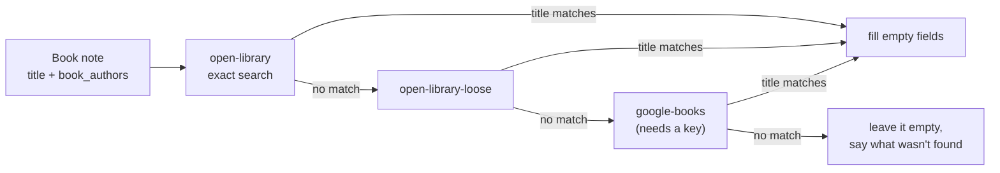

# Metafetch Looks Up Your Books: ISBNs, Goodreads, Open Library

## Why Care?

A good citation for a book needs boring facts: the ISBN, the publisher, the year, where it was printed. Nobody wants to type those, and a language model asked for them will cheerfully make up an ISBN that looks perfect and points nowhere.

So we stopped asking. Metafetch now looks the book up in a real catalogue, keeps the answer only when the title matches, and leaves the field empty when it isn't sure. On our own vault's 106 book notes, it filled 92 in about two minutes.

## What's New?

- **Fetch book reference details for frontmatter.** One command, on any book note in any folder. A Books profile is built in, and a `books.md` in `zz-cf-lib/frontmatter/` (which **Create example frontmatter profile** writes) replaces it, so you can change the fields. Under `Sources/Books/`, **Fill frontmatter from folder profile** does the same. It fills `isbn_13`, `isbn_10`, `subtitle`, `book_authors`, `publisher`, `publisher_city`, `year_first_published`, `open_library_url`, `goodreads_url`, and `google_books_url`, but only the ones still empty.
- **No `url` needed.** Most book notes don't have one. The lookup uses the note's `title` and first `book_authors` entry instead.
- **Open Library, free and keyless.** Two recipes: an exact search that returns one edition (so the ISBN and publisher belong to the same printing), and a looser one for spelling and name variants, like "Tom Nichols" vs. "Thomas M. Nichols".
- **Real Goodreads links, never guessed.** `goodreads_url` is written only when Open Library holds a Goodreads ID for the book. That was 41 of our 92.
- **Google Books, with a key.** Google stopped answering keyless requests, so the recipe is ready but waits for a Books API key in settings.

| Field | Notes filled on the first run |
|---|---|
| `open_library_url` | 92 |
| `isbn_13` | 90 |
| `isbn_10` | 84 |
| `goodreads_url` | 41 |
| `book_authors`, `year_first_published` | 16 each |
| `publisher` | 14 |
| `subtitle` | 9 |

## How it Works

The note's title gets searched without any subtitle run on after a colon or a spaced dash, so a note titled *Blue Ocean Strategy: How to Create Uncontested Market Space…* still finds *Blue Ocean Strategy*. The match ignores case and punctuation but nothing else: *Chip War Summary* is not *Chip War*.

## Under the Hood

Everything book-specific lives in data: two recipe definitions and one profile file. The engine picked up four general tools along the way, and any recipe can use them:

- **`{{fm.<key>}}`** puts a frontmatter value into a recipe's request. A list gives its first item, a `[[wikilink]]` gives its text, and an author written as `- name: B. Joseph Pine II` gives the name.
- **`{{title_main}}`** is the title without its run-on subtitle.
- **`[~regex]`** in an output path picks the first list item matching a pattern. Open Library returns a jumble of ISBN-10s and ISBN-13s, and `isbn[~^97\d{11}$]` picks out the 13-digit one.
- **`format:`** on a profile field wraps a value, turning Goodreads ID `13530973` into `https://www.goodreads.com/book/show/13530973`.

The tests caught a real bug during the build. The loose search's ISBN list had a Mexican edition of *Chip War* first, and an early version paired one printing's ISBN-13 with another's ISBN-10. Now both Open Library recipes prefer English-language ISBNs (groups 0 and 1), and the loose one doesn't give an ISBN-10 at all.

What's still imperfect: the edition Open Library ranks best isn't always the one your note names. For *Chip War*, it picked Simon & Schuster UK where our note says Scribner. Open Library drops the edition entirely if you add the publisher to the query, so the profile says so plainly: check the ISBN when the printing matters.

## What's Next

- **AMA citations in Cite Wide.** These fields are the raw material. Cite Wide will read them and format the citation, rather than fetching anything itself.
- **The 14 that didn't match.** Some are papers or manifestos rather than books (*A Mathematical Theory of Communication*, *The Agile Manifesto*). Others are listed under another title: Open Library files *The Design of Everyday Things* under its first-edition name, *The Psychology of Everyday Things*.
